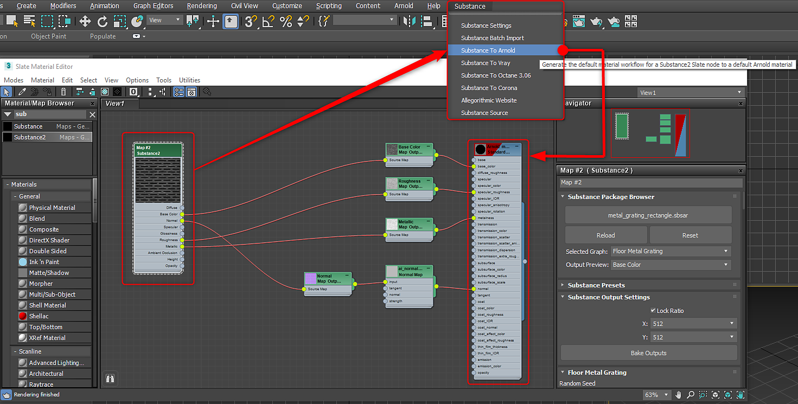

# 3ds Max中的Substance概述

## 增效工具概述

## 打开Substance

1. 打开Slate编辑器，搜索Substance并将Substance2节点拖动到视图中。
1. 双击Substance节点以激活属性，然后在“Substance包浏览器”下加载一个Substance。

   >[!NOTE]
   >
   > 您还可以将.node拖放到石板编辑器中，以自动创建sbsar 文件并导入sbar。

1. 如果Substance包含多个图形，则可以在所选图形下拉菜单中选择要输出为材料的图形。

   

1. 选择Substance节点后，转到“Substance”菜单并选择支持的渲染器。 此时将创建材料并准备将其应用于对象。 纹理会挂接到渲染材料中。

>[!NOTE]
>
> 选择&#x200B;**Substance2“**”节点后，需要先单击&#x200B;**加载Substance...**&#x200B;以选择一个sbsar 文件，然后从顶部菜单中选择支持的渲染器（例如“Substance到Arnold”）。
>
>支持的渲染器包括Arnold、V-Ray、Corona和Octane。 [了解3DS Max中的工作流程，了解如何使用材料。](../using-workflows-3ds-max/using-workflows-in-3ds-max.md)

## 更改分辨率

1. 在“Substance输出设置”中为计算的Substance纹理设置所需分辨率。
1. 要获得高达8K的分辨率，请确保您使用的是GPU引擎，该工具在[Substance设置](../../../3d-applications/3ds-max/settings-1/substance-settings.md)中设置。

   

## 更改参数

1. 双击Substance节点，在参数窗口中加载Substance参数。
1. 更改参数以自动更新纹理。

   {width="500px"}

## 设置输出预览

您可以为Substance节点的缩览图设置特定声道。

1. 在“输出预览”下拉列表中，选择要用于节点缩览图的通道。

   

## Substance

您可以使用“坐标”属性来平铺纹理和设置“映射通道”。

## OpenPBR工作流

**工作流程列表**&#x200B;中提供了两个OpenPBR工作流程（从&#x200B;**Substance菜单**）： **Substance到OpenPBR**&#x200B;和&#x200B;**Substance到V-RayOpenPBR**。 这些工作流程专为与使用Substance 3D Designer或Sampler中的OpenPBR材质模型创作的SBSAR文件结合使用而设计（自Designer V16.0+和Sampler V6.0+以来，OpenPBR一直是默认模型）。

### 什么是OpenPBR？

OpenPBR是由Adobe和Autodesk开发的开放、基于物理的材料着色模型，为学院软件基金会(ASWF)做出了贡献。 它提供了统一的材料定义，可在各个渲染器之间兼容。 有关详细信息，请访问[OpenPBR文档](https://experienceleague.adobe.com/zh-hans/docs/substance-3d/general-knowledge/openpbr/openpbr-overview)。

### 何时使用OpenPBR工作流程

当使用Substance 3D Designer或Substance 3D Sampler中的OpenPBR材质模型创作Sbsar 文件时，请使用OpenPBR工作流程。 如果您的SBSAR是使用Adobe标准材质模型(ASM)创作的，请使用与渲染器兼容的旧版工作流程（Arnold、V-Ray或V-Ray 6）。

>[!NOTE]
>
> 如果将OpenPBR工作流程应用于ASM材料，或将标准工作流程应用于OpenPBRSBSAR，则该增效工具将仅连接两个材质模型共用的输出。 结果可能不完整。

### 可用的OpenPBR工作流

**OpenPBR**

使用本机3ds Max openPBRSurface节点。 与Arnold和V-Ray兼容。 对于在3ds Max中使用材料的大多数用户，建议使用此工作流程。

**OpenPBR- V-Ray**

在OpenPBR模式下使用V-Ray材料(VRayMtl)。 建议用户将其管道专门围绕V-Ray材料设置构建。

### 如何应用OpenPBR工作流程

1. 使用“加载Sbsar 文件”按钮选择您的Substance(OpenPBR)。
1. 在顶部菜单中，选择OpenPBR或OpenPBR- V-Ray。
1. 单击“创建网络”以在Slate材料编辑器中创建着色器网络。
1. 该插件自动将SBSAR输出连接到OpenPBR节点的相应输入。
1. 照常将材料分配给网格。

